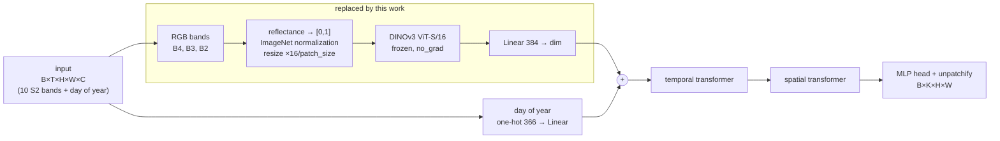
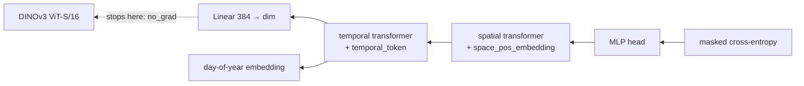

# DeepSatModels: crop type mapping from Sentinel-2 time series

The model labels every 10 m x 10 m pixel of a satellite image with one of 19 classes (18 crop types plus background). Its input is a series of up to 60 Sentinel-2 images of the same area over one growing season in France (the PASTIS24 dataset). The intended users are students and researchers who need a crop map for a small area.

The original repository by Michail Tarasiou accompanies two papers: TSViT (CVPR 2023) and CSCL (IEEE TGRS 2022). This branch adds the `TSViT_DINOv3` model and a demo app.

Scope of this version:

- Train and evaluate `TSViT_DINOv3` on PASTIS24 fold 1.
- Evaluate a checkpoint on the test split with the `--test_only` flag.
- Streamlit demo app: select an area on the image and see the crop map and the area (ha) of each crop. The app uses predictions precomputed for 25 patches.

The older models (UNet3D, BiConvRNN, CSCL) are still in the repository but are not covered here. See [README_TSVIT.md](README_TSVIT.md) and [README_CSCL.md](README_CSCL.md).

| Item | Value |
| --- | --- |
| Maintainer | quanluuu (GitHub) |
| Repository | https://github.com/quanluuu/DeepSatModels |
| Model version | `TSViT_DINOv3` fold 1, warm-start run T9 (30 epochs) |
| README updated | 2026-10-31 |

## 1. System overview

```text
configs/*.yaml ──> data/ (pickle -> tensor) ──> train_and_eval/ ──> best.pth + TensorBoard log
       │                                              ▲    │
       └──────────> models/ (get_model) ──────────────┘    └──> metrics/ (loss, mIoU, OA)

best.pth ──> app/precompute.py (run once, needs GPU) ──> app/data/demo_patches.npz ──> Streamlit app
```

Main flow:

1. A config file in `configs/` selects the model, the dataset and the training settings.
2. `data/` reads each pickle file (one 24 x 24 pixel window), normalizes the 10 spectral bands, appends a day-of-year channel, and pads or cuts the series to 60 dates.
3. `models/` builds the model. In `TSViT_DINOv3`, each RGB frame goes through a frozen DINOv3 ViT-S/16, then through the TSViT temporal and spatial transformers.
4. `train_and_eval/segmentation_training_transf.py` trains, evaluates on the eval split every 2000 steps, and overwrites `best.pth` when mIoU improves.
5. `app/precompute.py` runs `best.pth` on 25 test patches and saves the result to `demo_patches.npz`. The app only reads this file.

| Component | Runs on | Needs GPU |
| --- | --- | --- |
| Training, evaluation | Machine with an NVIDIA GPU, or Kaggle (T4) | Yes |
| `app/precompute.py` | Kaggle or a machine with a GPU | Runs on CPU, slowly |
| Demo app | Local machine or Streamlit Community Cloud | No |

The architecture is described in section 2. Running on Kaggle is described in [KAGGLE.md](KAGGLE.md).

## 2. Model architecture: TSViT + DINOv3

**`TSViT_DINOv3`** is a variant of [TSViT](README_TSVIT.md) in which the linear patch embedding is
replaced by a **frozen [DINOv3](https://github.com/facebookresearch/dinov3) ViT-S/16** that encodes every RGB frame
of the time series. Everything after the patch embedding — temporal encoder, spatial encoder, segmentation head — is
unchanged from TSViT.

Model code: [`models/TSViT/TSViT_dinov3.py`](models/TSViT/TSViT_dinov3.py) ·
Config: [`configs/PASTIS24/TSViT_DINOv3_fold1.yaml`](configs/PASTIS24/TSViT_DINOv3_fold1.yaml)

### 2.1 Where DINOv3 goes in TSViT

TSViT tokenizes each frame with a single linear layer over `patch_size × patch_size` pixels of all spectral bands.
`TSViT_DINOv3` swaps exactly that layer for a pretrained image encoder:



| Stage | TSViT (`models/TSViT/TSViTdense.py`) | TSViT_DINOv3 (`models/TSViT/TSViT_dinov3.py`) |
|---|---|---|
| Bands used for tokens | all 10 Sentinel-2 bands | RGB only (B4, B3, B2) |
| Patch embedding | `Linear(10·p², dim)` on each `p×p` patch, trainable | frozen DINOv3 ViT-S/16 + trainable `Linear(384, dim)` |
| Patch grid (PASTIS24, 24×24) | `patch_size: 2` → 12×12 | `patch_size: 4` → 6×6 |
| Temporal / spatial transformers, head | — | unchanged |
| Trainable parameters | 1.66 M | 1.69 M (of 23.29 M total) |

The core of the change in `forward`:

```python
# TSViT: linear projection of raw pixels
x = self.to_patch_embedding(x)            # Rearrange to patches + nn.Linear(patch_dim, dim)

# TSViT_DINOv3: frozen DINOv3 on each RGB frame, then a trainable projection
frames = self.rgb_to_backbone_input(x[:, :, self.rgb_idx])          # (B*T, 3, 96, 96)
with torch.no_grad(), torch.autocast(...):
    tokens = self.backbone.forward_features(frames)['x_norm_patchtokens']   # (B*T, 36, 384)
x = self.to_patch_embedding(tokens.float())                         # nn.Linear(384, dim)
x = rearrange(x, '(b t) n d -> b n t d', b=B)
```

### 2.2 Design details

- **Grid alignment.** Each 24×24 frame is resized by `16 / patch_size` (×4 → 96×96). DINOv3's 16-pixel patches then
  produce a 6×6 token grid that matches TSViT's 6×6 patch grid one-to-one, so the spatial encoder and the unpatchify
  step need no changes.
- **Radiometry.** Inputs arrive normalized per band by the PASTIS transforms. The RGB bands are mapped back to
  reflectance with the same statistics, divided by a fixed `rgb_scale: 3000`, clipped to [0, 1] and normalized with the
  ImageNet mean/std used by the DINOv3 web weights. A fixed global scale (not a per-image stretch) keeps brightness
  comparable across dates, which carries phenological signal.
- **Frozen backbone.** DINOv3 has `requires_grad=False`, always runs in `eval()` mode (also when the model is in
  `train()`), and runs under `torch.no_grad()`. Precision is picked from the GPU's compute capability: bf16 (≥ 8.0),
  fp16 (≥ 7.0), fp32 otherwise.
- **Warm start.** The temporal parts (`to_temporal_embedding_input`, `temporal_token`, `temporal_transformer`) can be
  initialized from a TSViT checkpoint; the projection, spatial encoder and head start from scratch. This uses the new
  `CHECKPOINT.restore_prefixes` option of `load_from_checkpoint`.


### 2.3 Loss

Training uses the repository's `masked_cross_entropy`
([`metrics/loss_functions.py`](metrics/loss_functions.py), `MaskedCrossEntropyLoss`), a per-pixel cross-entropy that
skips unlabeled pixels. The model outputs logits `B×K×H×W` (K = 19 classes); they are permuted to `B×H×W×K` and

$$
\mathcal{L} = -\frac{1}{|M|}\sum_{p \in M} \log \mathrm{softmax}(z_p)_{y_p},
\qquad M = \lbrace p : y_p \neq 19 \rbrace
$$

where `z_p` are the logits of pixel `p` and `y_p` its label. The mask `M` comes from the `UnkMask` transform and drops
PASTIS' void label (19). The background class (0) is kept (`ignore_background: False`) and no class weights are used
(`class_weights:` empty), so every labeled pixel counts equally.

### 2.4 What the gradients update



| Parameters | Updated by the loss? |
|---|---|
| `mlp_head`, `space_transformer`, `space_pos_embedding` | yes (random init) |
| `temporal_transformer`, `temporal_token`, `to_temporal_embedding_input` | yes (warm-started from TSViT, then fine-tuned) |
| `to_patch_embedding` (`Linear(384, dim)`) | yes (random init) |
| `backbone.*` (DINOv3) | **no**: tokens are computed under `torch.no_grad()` and `requires_grad=False`, so their gradient is `None` |

The optimizer is AdamW over `net.parameters()` with `weight_decay: 0`. The backbone parameters are in that list
(`get_net_trainable_params` does not filter them) but AdamW skips parameters whose gradient is `None`, so the DINOv3
weights stay exactly as loaded.

### 2.5 Learning-rate schedule

`build_scheduler` ([`utils/lr_scheduler.py`](utils/lr_scheduler.py)) creates a timm cosine scheduler counted in steps:

- linear warm-up from `lr_start` = 1e-8 to `lr_base` = 1e-3 over `num_warmup_epochs` (3 epochs = 2274 steps),
- cosine decay to `lr_min` = 5e-6 at the end of training (30 epochs = 22740 steps).

`segmentation_training_transf.py` calls `scheduler.step_update(abs_step)` once per epoch, after the step loop. The
learning rate is therefore constant within an epoch and jumps at epoch boundaries: epoch 1 runs at 1e-8 (no learning,
loss stays at ~ln 19), epoch 2 at ~3.3e-4, epoch 3 at ~6.7e-4, then 1e-3 decaying. This is pre-existing behavior and
also applies to the TSViT baseline.

### 2.6 Model selection

Every `eval_steps` (2000) training steps the model is evaluated on the eval split; `best.pth` is overwritten whenever
the eval macro IoU improves. The test split is only used afterwards, through `--test_only`.

## 3. Environment

| Item | Requirement | Tested on |
| --- | --- | --- |
| OS | Windows 10/11 or Linux | Windows (dev machine), Kaggle Linux |
| Python | 3.11 or newer (required by DINOv3) | 3.13 (dev machine), Kaggle's preinstalled version |
| PyTorch | 2.4 or newer, CUDA build matching the GPU | 2.11.0+cu128 |
| GPU for training | NVIDIA with CUDA. The script exits if no GPU is found | Tesla T4 16 GB: batch 48 uses 6.83 GiB; MX550: batch 1 |
| Demo app | Python 3.11+, no GPU | |

Files needed before running (not tracked in Git):

| File | Where to get it | Used for |
| --- | --- | --- |
| `PASTIS24/` folder (`pickle24x24/`, `fold-paths/*.csv`) | [TSViT author's Google Drive](https://drive.google.com/drive/folders/1Lm0repzD_1NVcECsrwF8Q3bP2XEp2a0y) | Training, evaluation, precompute |
| `facebookresearch/dinov3` repository, commit `6876159` | https://github.com/facebookresearch/dinov3 | Building the backbone |
| `dinov3_vits16_pretrain_lvd1689m-08c60483.pth` | Request access on the DINOv3 page, under the DINOv3 License | Backbone weights |
| Original TSViT fold 1 `best.pth` | `TSViT_fold1_full_a100_opt/best.pth` or the [5-fold checkpoints](https://drive.google.com/file/d/1GQSNt4DzXt9tBwANnURYQNsVtQtRLRWW/view?usp=sharing) | Warm-starting the temporal part |
| `TSViT_DINOv3` `best.pth` | Output of the Kaggle notebook (run T9) | Test evaluation, precompute |

The demo app only needs `app/data/demo_patches.npz`, which is already in the repository.

## 4. Setup

Run every command from the repository root. The scripts read `data/datasets.yaml` by relative path, so running from another folder raises `FileNotFoundError`.

1. Clone the repository

```bash
git clone https://github.com/quanluuu/DeepSatModels.git
cd DeepSatModels
```

2. Create a virtual environment

```bash
python -m venv .venv
.venv\Scripts\activate        # Windows
source .venv/bin/activate     # Linux, macOS
```

Check: the prompt starts with `(.venv)` and `python --version` prints `Python 3.11` or newer.

3. Install PyTorch for your GPU generation, then the rest

```bash
pip install torch torchvision --index-url https://download.pytorch.org/whl/cu128   # Turing or newer (RTX, T4, MX550)
pip install torch torchvision --index-url https://download.pytorch.org/whl/cu126   # Pascal (GTX 10xx)
pip install -r requirements_dinov3.txt
```

On Kaggle or Colab, skip the torch line and keep the preinstalled version.

Check:

```bash
python -c "import torch; print(torch.__version__, torch.cuda.is_available())"
python -c "from models import get_model"
```

Expected: the first line prints the version followed by `True`; the second prints nothing and raises no error.

4. Install the demo app libraries (only needed for the app)

```bash
pip install -r requirements.txt
```

5. Place the data and model files, then set the paths

The repository does not use a `.env` file. Paths live in two YAML files and currently hold placeholders of the form `/kaggle/input/<dataset-...>/`. For a local run, replace them with the real paths on your machine:

| File | Key | Meaning |
| --- | --- | --- |
| `data/datasets.yaml` | `PASTIS24_fold1.basedir` | The `PASTIS24/` folder |
| `data/datasets.yaml` | `paths_train`, `paths_eval`, `paths_test` | `fold-paths/folds_1_123_paths.csv`, `fold_4_paths.csv`, `fold_5_paths.csv` |
| `configs/PASTIS24/TSViT_DINOv3_fold1.yaml` | `MODEL.dinov3_repo` | The cloned DINOv3 repository |
| `configs/PASTIS24/TSViT_DINOv3_fold1.yaml` | `MODEL.dinov3_weights` | The file `dinov3_vits16_pretrain_lvd1689m-08c60483.pth` |
| `configs/PASTIS24/TSViT_DINOv3_fold1.yaml` | `CHECKPOINT.load_from_checkpoint` | The original TSViT `best.pth`; leave empty for random initialization |
| `configs/PASTIS24/TSViT_DINOv3_fold1.yaml` | `CHECKPOINT.save_path` | Where the new `best.pth` and logs are written |

The only environment variable is `DEMO_DATA` (optional): the npz file the app reads, default `app/data/demo_patches.npz`.

DINOv3 weights and all `.pth` files must not be committed (they are listed in `.gitignore`).

## 5. Run and verify

### 5.1 Quick check, no data or GPU needed

```bash
python -m models.TSViT.TSViT_dinov3
python -m app.demo_core
```

Expected:

```text
TSViT_DINOv3 self-check passed
demo_core self-check passed
```

If `TSViT_fold1_full_a100_opt/best.pth` exists, the first command also prints `warm-start check passed`. It uses a stub backbone, so the DINOv3 weights are not needed.

### 5.2 Data check

```bash
python -c "from utils.config_files_utils import read_yaml; from data import get_dataloaders; c = read_yaml('configs/PASTIS24/TSViT_DINOv3_fold1.yaml'); b = next(iter(get_dataloaders(c)['train'])); print({k: tuple(v.shape) for k, v in b.items()})"
```

Expected (batch 48):

```text
{'inputs': (48, 60, 24, 24, 11), 'labels': (48, 24, 24, 1), 'seq_lengths': (48,), 'unk_masks': (48, 24, 24, 1)}
```

### 5.3 Training

```bash
python train_and_eval/segmentation_training_transf.py --config configs/PASTIS24/TSViT_DINOv3_fold1.yaml --device 0
```

Always pass `--device`. The default is `0,1`, which fails on a single-GPU machine. On a T4, one epoch takes about 16.8 minutes; 30 epochs with evaluation take about 10 hours.

A correct log looks like this, printed every 250 steps:

```text
abs_step: 250, epoch: 1, step:   250, loss: ..., batch_iou: ..., batch accuracy: ...
```

During epoch 1 the loss stays around 3.0 (close to ln 19). This is known behavior, see section 8. From epoch 2 the loss should drop clearly.

Outputs go to `save_path`: `best.pth`, `config_file.yaml` and the TensorBoard log. To view the log:

```bash
tensorboard --logdir models/saved_models/PASTIS24/TSViT_DINOv3_fold1
```

### 5.4 Test-split evaluation

```bash
python train_and_eval/segmentation_training_transf.py --config configs/PASTIS24/TSViT_DINOv3_fold1.yaml --device 0 --test_only <path to best.pth>
```

This command neither trains nor writes files. With the run T9 checkpoint, the result line contains these numbers (iou and accuracy are printed as micro/macro pairs):

```text
test split metrics for .../best.pth
Mean (micro) Evaluation metrics (micro/macro), loss: ..., iou: 0.6605/0.5393, accuracy: 0.7955/0.6552, ...
```

### 5.5 Demo app

```bash
streamlit run app/crop_recognition_app.py
```

Expected: the terminal prints `Local URL: http://localhost:8501`. At that address the page is titled "Crop recognition", the left column has an "Analyze selected area" button, and the right column shows the satellite image with a white "Selected area" frame.

To rebuild `demo_patches.npz` from a new checkpoint (on Kaggle or a machine with PASTIS24):

```bash
python -m app.precompute --config configs/PASTIS24/TSViT_DINOv3_fold1.yaml --checkpoint <best.pth> --num-patches 25 --out app/data/demo_patches.npz
```

Expected: the last line prints `saved app/data/demo_patches.npz (0.87 MB)` or a similar size, and the `mean seam` line shows a smaller `row-major` value than `column-major`.

## 6. Using the demo app

1. Pick a patch in "Available region (1.2 km × 1.2 km)". There are 25 patches from the fold 1 test split.
2. Select an area: click the rectangle tool on the map and drag, or click "Whole region" for the full patch. "Reselect area" resets to the default 60 x 60 pixel area.
3. Click "Analyze selected area". The area is colored by predicted class, and the left column shows a table of the area (ha) of each crop, plus background and total.
4. Turn on "Show ground truth (PASTIS)" to see the true labels instead of the prediction. The area table is still computed from the prediction.

The figure below is built from `demo_patches.npz` itself (patch 10082, the full 144 ha) and shows the image, the prediction and the ground truth side by side:


For this area the app's table lists the three largest classes as Soft winter wheat 28.75 ha, Winter barley 26.99 ha and Beet 26.59 ha, with 25.99 ha of background.

The app has no API. Predictions are precomputed; the app does not run the model.

## 7. AI model

| Item | Details |
| --- | --- |
| Model name | `TSViT_DINOv3` (`models/TSViT/TSViT_dinov3.py`) |
| Checkpoint | `best.pth` from run T9; about 89 MB because it includes the DINOv3 weights |
| Task | Semantic segmentation: one class per pixel |
| Input | Tensor `B x T x 24 x 24 x 11`, T up to 60 dates. The first 10 channels are Sentinel-2 bands normalized with fold 1 statistics; the last channel is the day of year divided by 365.0001 |
| DINOv3 input | Only bands B4, B3, B2 (`rgb_idx: [2, 1, 0]`), converted back to reflectance, divided by 3000, resized from 24 to 96 pixels |
| Output | Logits `B x 19 x 24 x 24`. The predicted class is the `argmax` over the 19 classes |
| Classes | 0 Background, 1 Meadow, 2 Soft winter wheat, 3 Corn, 4 Winter barley, 5 Winter rapeseed, 6 Spring barley, 7 Sunflower, 8 Grapevine, 9 Beet, 10 Winter triticale, 11 Winter durum wheat, 12 Fruits/vegetables/flowers, 13 Potatoes, 14 Leguminous fodder, 15 Soybeans, 16 Orchard, 17 Mixed cereal, 18 Sorghum. Label 19 is void and ignored |
| Parameters | 1.69 million trainable out of 23.29 million total; DINOv3 is frozen |
| Threshold | None; every pixel gets the highest-scoring class |
| Test result (fold 5) | mIoU 53.9%, OA 79.6% |
| Comparison | Original TSViT reports 65.9% mIoU (from README_TSVIT.md; not rerun on the same fold and scripts) |

Known limitations:

- Overfitting: eval loss rises from 0.577 at step 4000 to 0.965 at step 22000, and eval mIoU plateaus from about epoch 11. The config uses no weight decay and no data augmentation.
- DINOv3 sees only 3 of the 10 bands and was trained on web images, which differ from 10 m satellite imagery.
- 4 x 4 pixel patches give coarser field boundaries than the original TSViT (2 x 2 patches).
- Trained and evaluated on one fold and one season (September 2018 to November 2019) in France. Other regions and years are untested.
- The 25 demo patches were picked for having the most crop types, not at random. Do not use the demo to estimate accuracy.

## 8. Troubleshooting

| Error | Likely cause | Fix |
| --- | --- | --- |
| `ModuleNotFoundError: timm` (or `einops`, `omegaconf`) | Dependencies not installed | `pip install -r requirements_dinov3.txt` |
| `ModuleNotFoundError: streamlit` or `folium` | App dependencies not installed | `pip install -r requirements.txt` |
| `unrecognized arguments: --config_file --gpu_ids` | Old command from README_TSVIT.md | This script takes `--config` and `--device` |
| `No allowed device is found` | No CUDA GPU, or the CPU build of torch is installed | Check `torch.cuda.is_available()`; reinstall torch as in step 3 |
| `invalid device id` | `--device` omitted; the default `0,1` needs 2 GPUs | Add `--device 0` |
| `FileNotFoundError` with `/kaggle/input/<dataset-...>` | Placeholder paths not replaced | Edit them as in step 5 |
| `FileNotFoundError: data/datasets.yaml` | Command run outside the repository root | `cd` to the root and run again |
| Error in `torch.hub.load` for DINOv3 | Wrong `dinov3_repo` or missing weights file | Check the `dinov3_repo` and `dinov3_weights` keys |
| CUDA out of memory | Batch 48 is too large for the GPU | Lower `DATASETS.train.batch_size` in the config |
| Loss stays around 3.0 for all of epoch 1 | The learning rate updates only at the end of each epoch, so epoch 1 runs at 1e-8 | Expected; keep it to stay comparable with run T9 |
| App shows `Demo data not found` | `app/data/demo_patches.npz` missing or `DEMO_DATA` wrong | Pull the file from Git or run `app/precompute.py` |
| Kaggle unpacks `best.zip` into a `best/` folder | PyTorch checkpoints are zip files | Rename to `.pth` before uploading; re-zipping steps are in [KAGGLE.md](KAGGLE.md) |

## 9. Open work

- Evaluate the TSViT baseline on the same fold 5 test split (T7).
- Train `TSViT_DINOv3` from random initialization to isolate the effect of warm-starting (T10).
- Deploy the app to Streamlit Community Cloud after checking whether the PASTIS license allows redistribution.

## References and license

- Tarasiou, Chavez, Zafeiriou, [ViTs for SITS](https://openaccess.thecvf.com/content/CVPR2023/html/Tarasiou_ViTs_for_SITS_Vision_Transformers_for_Satellite_Image_Time_Series_CVPR_2023_paper.html), CVPR 2023.
- Tarasiou, Güler, Zafeiriou, [Context-self contrastive pretraining for crop type semantic segmentation](https://ieeexplore.ieee.org/abstract/document/9854891), IEEE TGRS 2022.
- Siméoni et al., [DINOv3](https://github.com/facebookresearch/dinov3), Meta AI. Code and weights under the DINOv3 License.
- Sainte Fare Garnot, Landrieu, [PASTIS](https://github.com/VSainteuf/pastis-benchmark), 2021. Demo data derived from PASTIS ([CC BY 4.0](https://zenodo.org/records/5012942)).

Code released under the Apache License 2.0, see [LICENSE.txt](LICENSE.txt). Copyright © 2023 Michail Tarasiou.
