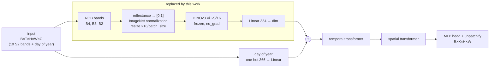

# TSViT + DINOv3: a frozen foundation-model encoder for satellite image time series

This branch adds **`TSViT_DINOv3`**, a variant of [TSViT](README_TSVIT.md) in which the linear patch embedding is
replaced by a **frozen [DINOv3](https://github.com/facebookresearch/dinov3) ViT-S/16** that encodes every RGB frame
of the time series. Everything after the patch embedding — temporal encoder, spatial encoder, segmentation head — is
unchanged from TSViT.

Model code: [`models/TSViT/TSViT_dinov3.py`](models/TSViT/TSViT_dinov3.py) ·
Config: [`configs/PASTIS24/TSViT_DINOv3_fold1.yaml`](configs/PASTIS24/TSViT_DINOv3_fold1.yaml)

## Where DINOv3 goes in TSViT

TSViT tokenizes each frame with a single linear layer over `patch_size × patch_size` pixels of all spectral bands.
`TSViT_DINOv3` swaps exactly that layer for a pretrained image encoder:



| Stage | TSViT (`models/TSViT/TSViTdense.py`) | TSViT_DINOv3 (`models/TSViT/TSViT_dinov3.py`) |
|---|---|---|
| Bands used for tokens | all 10 Sentinel-2 bands | RGB only (B4, B3, B2) |
| Patch embedding | `Linear(10·p², dim)` on each `p×p` patch, trainable | frozen DINOv3 ViT-S/16 + trainable `Linear(384, dim)` |
| Patch grid (PASTIS24, 24×24) | `patch_size: 2` → 12×12 | `patch_size: 4` → 6×6 |
| Temporal / spatial transformers, head | — | unchanged |
| Trainable parameters | 1.66 M | 1.69 M (of 23.29 M total) |

The core of the change in `forward`:

```python
# TSViT: linear projection of raw pixels
x = self.to_patch_embedding(x)            # Rearrange to patches + nn.Linear(patch_dim, dim)

# TSViT_DINOv3: frozen DINOv3 on each RGB frame, then a trainable projection
frames = self.rgb_to_backbone_input(x[:, :, self.rgb_idx])          # (B*T, 3, 96, 96)
with torch.no_grad(), torch.autocast(...):
    tokens = self.backbone.forward_features(frames)['x_norm_patchtokens']   # (B*T, 36, 384)
x = self.to_patch_embedding(tokens.float())                         # nn.Linear(384, dim)
x = rearrange(x, '(b t) n d -> b n t d', b=B)
```

### Design details

- **Grid alignment.** Each 24×24 frame is resized by `16 / patch_size` (×4 → 96×96). DINOv3's 16-pixel patches then
  produce a 6×6 token grid that matches TSViT's 6×6 patch grid one-to-one, so the spatial encoder and the unpatchify
  step need no changes.
- **Radiometry.** Inputs arrive normalized per band by the PASTIS transforms. The RGB bands are mapped back to
  reflectance with the same statistics, divided by a fixed `rgb_scale: 3000`, clipped to [0, 1] and normalized with the
  ImageNet mean/std used by the DINOv3 web weights. A fixed global scale (not a per-image stretch) keeps brightness
  comparable across dates, which carries phenological signal.
- **Frozen backbone.** DINOv3 has `requires_grad=False`, always runs in `eval()` mode (also when the model is in
  `train()`), and runs under `torch.no_grad()`. Precision is picked from the GPU's compute capability: bf16 (≥ 8.0),
  fp16 (≥ 7.0), fp32 otherwise.
- **Warm start.** The temporal parts (`to_temporal_embedding_input`, `temporal_token`, `temporal_transformer`) can be
  initialized from a TSViT checkpoint; the projection, spatial encoder and head start from scratch. This uses the new
  `CHECKPOINT.restore_prefixes` option of `load_from_checkpoint`.

## Loss and parameter updates

### Loss

Training uses the repository's `masked_cross_entropy`
([`metrics/loss_functions.py`](metrics/loss_functions.py), `MaskedCrossEntropyLoss`), a per-pixel cross-entropy that
skips unlabeled pixels. The model outputs logits `B×K×H×W` (K = 19 classes); they are permuted to `B×H×W×K` and

$$
\mathcal{L} = -\frac{1}{|M|}\sum_{p \in M} \log \operatorname{softmax}(z_p)_{y_p},
\qquad M = \{\, p : y_p \neq 19 \,\}
$$

where `z_p` are the logits of pixel `p` and `y_p` its label. The mask `M` comes from the `UnkMask` transform and drops
PASTIS' void label (19). The background class (0) is kept (`ignore_background: False`) and no class weights are used
(`class_weights:` empty), so every labeled pixel counts equally.

### What the gradients update


| Parameters | Updated by the loss? |
|---|---|
| `mlp_head`, `space_transformer`, `space_pos_embedding` | yes (random init) |
| `temporal_transformer`, `temporal_token`, `to_temporal_embedding_input` | yes (warm-started from TSViT, then fine-tuned) |
| `to_patch_embedding` (`Linear(384, dim)`) | yes (random init) |
| `backbone.*` (DINOv3) | **no**: tokens are computed under `torch.no_grad()` and `requires_grad=False`, so their gradient is `None` |

The optimizer is AdamW over `net.parameters()` with `weight_decay: 0`. The backbone parameters are in that list
(`get_net_trainable_params` does not filter them) but AdamW skips parameters whose gradient is `None`, so the DINOv3
weights stay exactly as loaded.

### Learning-rate schedule

`build_scheduler` ([`utils/lr_scheduler.py`](utils/lr_scheduler.py)) creates a timm cosine scheduler counted in steps:

- linear warm-up from `lr_start` = 1e-8 to `lr_base` = 1e-3 over `num_warmup_epochs` (3 epochs = 2274 steps),
- cosine decay to `lr_min` = 5e-6 at the end of training (30 epochs = 22740 steps).

`segmentation_training_transf.py` calls `scheduler.step_update(abs_step)` once per epoch, after the step loop. The
learning rate is therefore constant within an epoch and jumps at epoch boundaries: epoch 1 runs at 1e-8 (no learning,
loss stays at ~ln 19), epoch 2 at ~3.3e-4, epoch 3 at ~6.7e-4, then 1e-3 decaying. This is pre-existing behavior and
also applies to the TSViT baseline.

### Model selection

Every `eval_steps` (2000) training steps the model is evaluated on the eval split; `best.pth` is overwritten whenever
the eval macro IoU improves. The test split is only used afterwards, through `--test_only`.

## Setup

Python ≥ 3.11 (required by DINOv3). Install PyTorch for your GPU, then the rest:

```bash
pip install torch torchvision --index-url https://download.pytorch.org/whl/cu128   # see requirements_dinov3.txt for other GPUs
pip install -r requirements_dinov3.txt
```

DINOv3 code and weights are **not included**:

1. Clone [facebookresearch/dinov3](https://github.com/facebookresearch/dinov3) (tested at commit `6876159`).
2. Request access to the weights under the DINOv3 License and download `dinov3_vits16_pretrain_lvd1689m-08c60483.pth`.
3. Set both paths in the config:

```yaml
MODEL:
  architecture: "TSViT_DINOv3"
  patch_size: 4
  dinov3_repo: "/path/to/dinov3"
  dinov3_weights: "/path/to/dinov3_vits16_pretrain_lvd1689m-08c60483.pth"
  rgb_idx: [2, 1, 0]        # B4, B3, B2 in PASTIS band order
  rgb_scale: 3000.

CHECKPOINT:
  load_from_checkpoint: "/path/to/TSViT/best.pth"   # empty = random init
  partial_restore: True
  restore_prefixes: ["to_temporal_embedding_input.", "temporal_token", "temporal_transformer."]
```

Point the PASTIS24 entries of [`data/datasets.yaml`](data/datasets.yaml) at your copy of the dataset.

## Usage

Run all commands from the repository root.

```bash
# self-check with a stub backbone (no weights, no GPU needed)
python -m models.TSViT.TSViT_dinov3

# train
python train_and_eval/segmentation_training_transf.py --config configs/PASTIS24/TSViT_DINOv3_fold1.yaml --device 0

# evaluate a trained checkpoint on the test split
python train_and_eval/segmentation_training_transf.py --config configs/PASTIS24/TSViT_DINOv3_fold1.yaml --device 0 \
    --test_only models/saved_models/PASTIS24/TSViT_DINOv3_fold1/best.pth
```

Step-by-step instructions for the Kaggle free tier (T4 GPU) are in [KAGGLE.md](KAGGLE.md).

## Results (PASTIS24, fold 1)

Trained on a Kaggle T4: batch 48, 30 epochs (3 warm-up), lr 1e-3 cosine, warm start from a TSViT fold-1 checkpoint.
About 10 h per run. Best checkpoint selected by eval-split mIoU (step 14000, epoch 19), reported on the test split.

| Model | Test mIoU | Test OA | Epochs |
|---|---|---|---|
| TSViT_DINOv3 (ViT-S/16 web, frozen, RGB, warm start) | 53.9 | 79.6 | 30 |
| TSViT baseline, same fold and scripts | *pending* | *pending* | 100 |

mIoU is the class-averaged (macro) IoU; OA is the overall pixel accuracy.

Observations from this run:

- The model overfits: eval loss rises from step ~4000 while train loss keeps falling, and eval mIoU plateaus around
  epoch 11 (`weight_decay: 0`, no augmentation).
- The first epoch does not learn because the learning-rate scheduler is only stepped at the end of each epoch in
  `segmentation_training_transf.py` (pre-existing behavior), so epoch 1 runs at `lr_start` = 1e-8.
- Likely reasons for the gap to TSViT: only 3 of 10 bands reach the model, coarser 4×4 output patches, and a domain gap
  between web-image features and 10 m Sentinel-2 imagery.

## Demo app

[`app/crop_recognition_app.py`](app/crop_recognition_app.py) is a Streamlit demo: pick a PASTIS test patch, select an
area of interest and see the predicted crop map and the area (ha) of each crop inside it. It reads predictions
precomputed by [`app/precompute.py`](app/precompute.py) (25 test patches of fold 1, stored in
`app/data/demo_patches.npz`), so it needs neither PyTorch nor the DINOv3 weights.

```bash
pip install -r app/requirements.txt
streamlit run app/crop_recognition_app.py
```

The demo data is derived from [PASTIS](https://zenodo.org/records/5012942) (CC BY 4.0): windows stitched into
120×120 patches, an RGB composite of the clearest date, and void labels shown as background.

## Other changes in this branch

| File | Change |
|---|---|
| `models/__init__.py` | `TSViT_DINOv3` architecture; `FCN_CRNN` imported lazily (no keras/torchfcn needed for TSViT) |
| `utils/torch_utils.py` | `load_from_checkpoint(..., restore_prefixes=...)` |
| `train_and_eval/segmentation_training_transf.py` | `partial_restore`/`restore_prefixes` read from config; `--test_only` flag |
| `data/__init__.py` | test-split dataloader for PASTIS |
| `data/datasets.yaml` | fixed double-nested `PASTIS24_fold1` entry |
| `data/France/dataloader.py` | removed stray lines that caused an `IndentationError` on import |
| `utils/config_files_utils.py` | `yaml.load(..., Loader=FullLoader)` for PyYAML ≥ 6 |

## Acknowledgements

TSViT: Tarasiou et al., [ViTs for SITS](https://openaccess.thecvf.com/content/CVPR2023/html/Tarasiou_ViTs_for_SITS_Vision_Transformers_for_Satellite_Image_Time_Series_CVPR_2023_paper.html), CVPR 2023.
DINOv3: Siméoni et al., [DINOv3](https://github.com/facebookresearch/dinov3), Meta AI; code and weights under the DINOv3 License.
